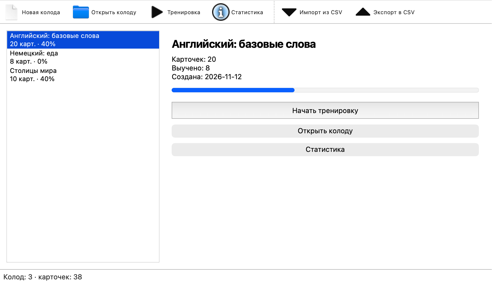
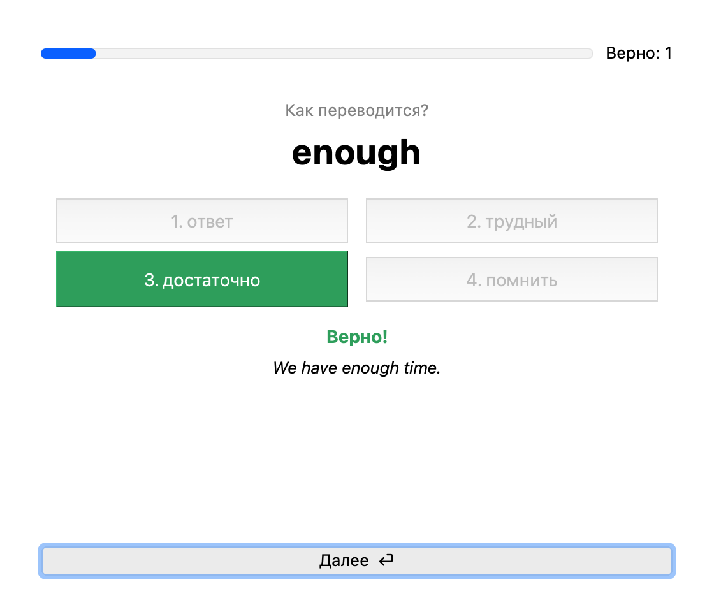
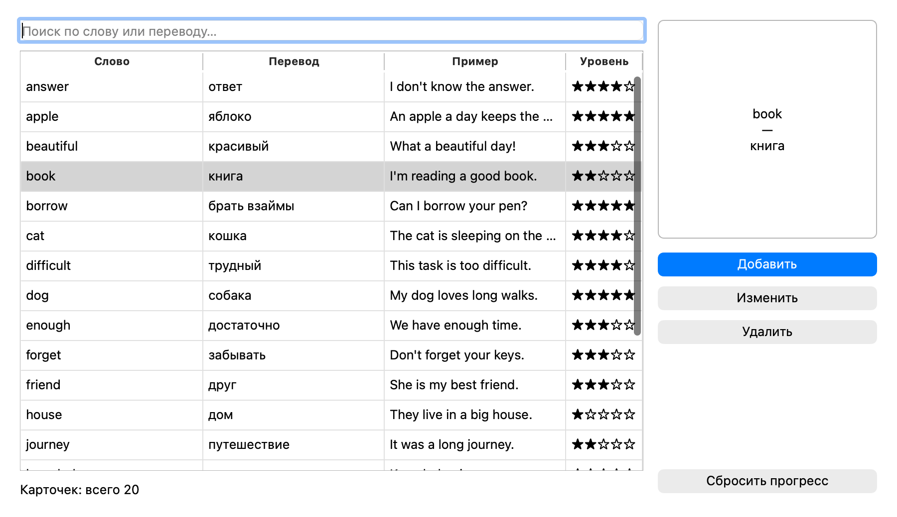
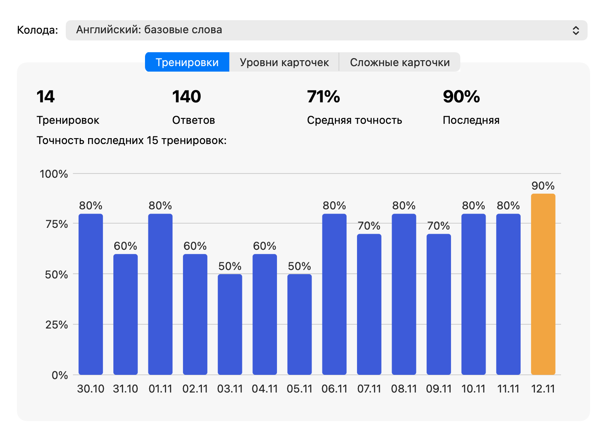

<div align="center">


# Flashdeck

**Карточки для запоминания слов** — колоды, тренировки и статистика прогресса.

[](LICENSE)
[](https://github.com/Denchikper/flashdeck/releases)


</div>

Собираешь колоды из слов (или любых пар «вопрос — ответ»), тренируешься —
приложение запоминает, какие карточки даются хуже, и показывает их чаще.
Всё хранится локально в SQLite, колоды можно переносить через CSV.

## Скриншоты

<table>
  <tr>
    <td width="50%"></td>
    <td width="50%"></td>
  </tr>
  <tr>
    <td align="center"><sub>Колоды и прогресс</sub></td>
    <td align="center"><sub>Тренировка — выбор из вариантов</sub></td>
  </tr>
  <tr>
    <td width="50%"></td>
    <td width="50%"></td>
  </tr>
  <tr>
    <td align="center"><sub>Редактор колоды</sub></td>
    <td align="center"><sub>Статистика — точность по дням</sub></td>
  </tr>
</table>

## Возможности

- **Колоды и карточки.** Слово, перевод, пример использования и картинка.
  Поиск по колоде без учёта регистра.
- **Два режима тренировки.** Ввод ответа с клавиатуры или выбор из четырёх
  вариантов (клавиши 1–4). Можно тренировать в обе стороны.
- **Слабые карточки — первыми.** У каждой карточки уровень 0–5: верный ответ
  поднимает его, ошибка опускает. С уровня 4 карточка считается выученной.
- **Снисходительная проверка.** Регистр, лишние пробелы и «ё/е» не важны;
  для перевода «дом, здание» засчитывается любой вариант.
- **Повтор ошибок** сразу после тренировки и **отчёт в TXT**.
- **Статистика.** График точности по тренировкам, распределение карточек
  по уровням, список самых сложных.
- **Импорт и экспорт CSV.** Разделитель `,` или `;`, заголовок необязателен —
  колоду можно собрать в Excel или Google Таблицах.

## Как это работает

Данные лежат в `~/.flashdeck/`: база `flashdeck.db` и папка `images/`
с картинками карточек. При первом запуске создаётся колода-пример
из 20 английских слов.

```
main.py                   точка входа
flashdeck/
    database.py           схема SQLite: decks, cards, sessions, answers
    repositories.py       все SQL-запросы, по классу на таблицу
    models.py             Deck, Card, Session
    trainer.py            логика тренировки — без интерфейса
    csv_io.py             импорт/экспорт CSV, отчёт TXT
    ui/                   окна; forms/ — формы из Qt Designer
tests/                    unittest: логика, БД, CSV
```

Интерфейс не знает про SQL, а логика тренировки — про Qt: `TrainingSession`
выбирает карточки, генерирует варианты и проверяет ответы, окно только
показывает результат. График статистики — свой виджет на `QPainter`.

Формат CSV:

```csv
word;translation;example
apple;яблоко;An apple a day keeps the doctor away.
```

## Установка

Готовый `Flashdeck_<версия>_Windows_x64.exe` — на странице
[релизов](https://github.com/Denchikper/flashdeck/releases). Установка не нужна:
это один файл. Он не подписан сертификатом, поэтому SmartScreen при первом
запуске предупредит — «Подробнее» → «Выполнить в любом случае».

## Запуск из исходников

Нужен Python 3.11+.

```bash
git clone https://github.com/Denchikper/flashdeck.git
cd flashdeck
python -m venv .venv
.venv/bin/pip install -r requirements.txt     # Windows: .venv\Scripts\pip
.venv/bin/python main.py
```

Тесты и сборка exe:

```bash
python -m unittest
pyinstaller flashdeck.spec      # результат — dist/Flashdeck(.exe)
```

## Лицензия

[MIT](LICENSE) © Daniel Benovich

---

<div align="center"><sub>by <a href="https://github.com/Denchikper">Benovich</a></sub></div>
